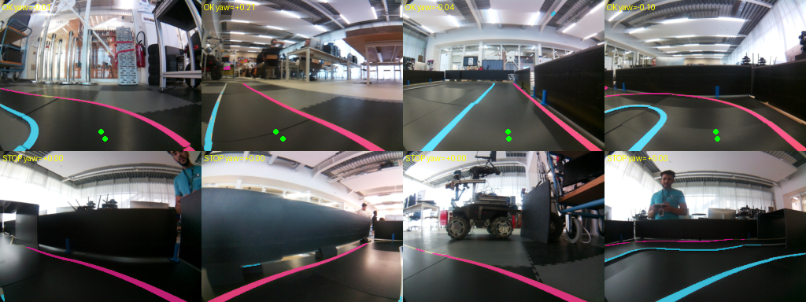

# TurtleBot3 Lane Follower — Machine Learning & Deep Learning with ROS 2

A TurtleBot3 Burger drives autonomously between a **yellow line (left)** and a **white line (right)** on an arena,
using **deep learning** to see the lines and a ROS 2 controller to steer.

> **Part 1** (classical computer vision with the ROBOTIS AutoRace packages, HSV thresholds):
> **[AkramSakly/turtlebot3-autorace-lane-follower](https://github.com/AkramSakly/turtlebot3-autorace-lane-follower)**

**Keywords:** machine learning · deep learning · supervised learning · semantic segmentation · U-Net · CNN ·
PyTorch · ONNX Runtime · ROS 2 Humble · TurtleBot3 · computer vision · autonomous driving

## Machine learning and deep learning in this project

| Step | What we did |
| --- | --- |
| **Data collection** | 334 camera images recorded on the arena in 13 sequences (lights on/off, both driving directions) |
| **Labelling** | 264 images annotated by hand with polygons (`yellow_line`, `white_line`, LabelMe format) |
| **Supervised learning** | Train / validation / test split (183 / 61 / 14 labelled images), duplicates removed between splits |
| **Deep learning model** | Two U-Net convolutional neural networks (CNN), one per line colour, pixel-wise semantic segmentation |
| **Training** | PyTorch, BCE + Dice loss (class weighting for thin lines), Adam optimiser, data augmentation (flip, brightness) |
| **Model selection** | Best epoch and decision threshold chosen on the validation set (IoU) |
| **Evaluation** | IoU, Dice/F1, precision, recall, specificity, pixel accuracy, confusion matrices, lane-centre error |
| **Deployment** | Export to ONNX, real-time inference (~31 images/s on CPU) inside a ROS 2 node driving the robot |



## Results

| Network | Split | IoU | Dice/F1 | Precision | Recall |
| --- | --- | --- | --- | --- | --- |
| Yellow | Test (14 img) | **0.828** | 0.906 | 0.893 | 0.919 |
| White | Test (14 img) | **0.764** | 0.866 | 0.872 | 0.861 |
| Yellow | Validation (61) | 0.718 | 0.836 | 0.829 | 0.842 |
| White | Validation (61) | 0.632 | 0.775 | 0.855 | 0.708 |

- Lane-centre error (256 px wide image): **median 0.25–0.63 px**, 0 false lane pairs in all splits.
- Inference: 13,665 parameters per network, ~16 ms each on a laptop CPU (ONNX Runtime), ~31 images/s for both.
- Images of the full dataset (334) that give a steering command: 48.5% → **90.4%** after supporting both driving directions.
- Real robot: smooth laps, tested from 0.035 to 0.15 m/s.

All metrics: [`results/metrics_all.md`](results/metrics_all.md) · full report: [`report/report.pdf`](report/report.pdf)

## How it works

```
Pi camera 320x240 ──► 2 U-Nets (PC, ONNX) ──► lane centre (near + far band) ──► controller ──► /cmd_vel
                                                                                     │
                         LANE ─► LANE (hold, 0.3 s) ─► RECOVERY (one line) ─► STOP ◄─┘
```

- **Network:** U-Net, 2 down / 2 up levels (8-12-16 channels), skip connections, 256x192 RGB input.
- **Training:** PyTorch, BCE (line pixels x8) + Dice loss, Adam lr 0.002, batch 8, 12 epochs, flip + brightness augmentation.
- **Dataset:** 334 images (800x600) in 13 sequences (lights on/off, normal/inverse direction); 264 labelled with LabelMe polygons.
- **Control:** proportional steering on centre + look-ahead, gains scaled with speed, smoothing, recovery when one line leaves the image.

## Repository layout

| Path | Content |
| --- | --- |
| `ros2_package/tb3_lane_center/` | ROS 2 package v0.4.0: node, vision, ONNX models, `train.py`, `train_with_loss_log.py`, `evaluate_all.py` |
| `scripts/start_robot.sh` | Opens 5 terminal tabs and starts everything (set `PI_IP` first) |
| `scripts/record_overlay.py` | Records the robot's view (`/lane_overlay`) to MP4 |
| `calibration/` | Camera calibration: original 800x600 and scaled 320x240 |
| `results/` | Metrics, per-image detection results, figures |
| `report/report.pdf` | Full project report |

## Install (PC, ROS 2 Humble)

```bash
sudo apt install ros-humble-cv-bridge python3-scipy python3-pil python3-numpy
pip install onnxruntime
mkdir -p ~/tb3_dl_ws/src && cp -r ros2_package/tb3_lane_center ~/tb3_dl_ws/src/
cd ~/tb3_dl_ws && colcon build --symlink-install --packages-select tb3_lane_center
source install/setup.bash
```

Camera calibration on the Pi:

```bash
mkdir -p ~/.ros/camera_info
cp calibration/ov5647__base_soc_i2c0mux_i2c_1_ov5647_36_320x240.yaml ~/.ros/camera_info/
```

## Run

```bash
# Pi, terminal 1
export TURTLEBOT3_MODEL=burger LDS_MODEL=LDS-01 ROS_DOMAIN_ID=30
ros2 launch turtlebot3_bringup robot.launch.py
# Pi, terminal 2
ros2 run camera_ros camera_node --ros-args -p format:='RGB888' -p width:=320 -p height:=240
# PC
ros2 run tb3_lane_center follow --ros-args -r image_raw:=/camera/image_raw -r lane_cmd_vel:=/cmd_vel \
  -p lane_side:=yellow_left -p max_camera_age:=0.6 -p max_speed:=0.10 -p recovery_time:=3.0
# Stop: Ctrl+C, then
ros2 topic pub --once /cmd_vel geometry_msgs/msg/Twist "{}"
```

| Parameter | Default | Meaning |
| --- | --- | --- |
| `max_speed` | 0.035 | top speed, m/s (≤ 0.22) |
| `lane_side` | auto | `yellow_left`, `yellow_right` or `auto` |
| `max_camera_age` | 0.4 | oldest image used, s |
| `recovery_time` | 1.5 | recovery duration, s (0 = off) |
| `hold_time` | 0.3 | keep last command when lane briefly lost, s |
| `smoothing` | 0.5 | command smoothing, 0–0.9 |

## Evaluate / retrain

```bash
cd ros2_package/tb3_lane_center
python3 evaluate_all.py /path/turtlebot3_autorace_dataset_to_fill.zip --out results_all
python3 train_with_loss_log.py /path/turtlebot3_autorace_dataset_to_fill.zip --label white_line --out run_white   # needs PyTorch
```

The dataset (~220 MB) is not included in this repository.

## License

MIT
