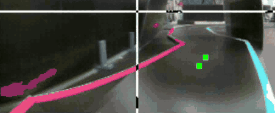
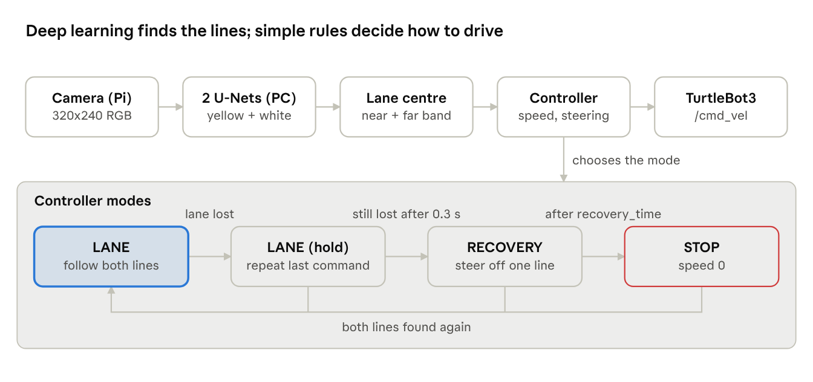
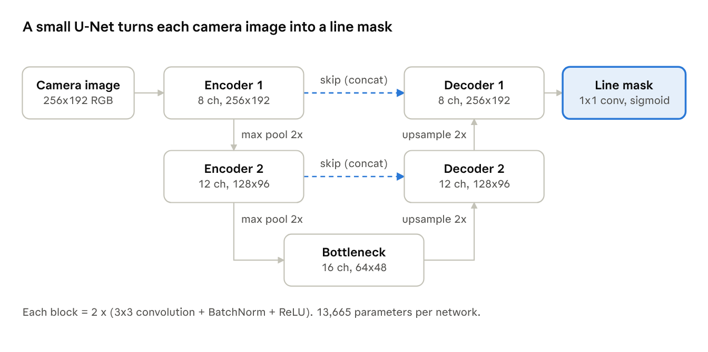
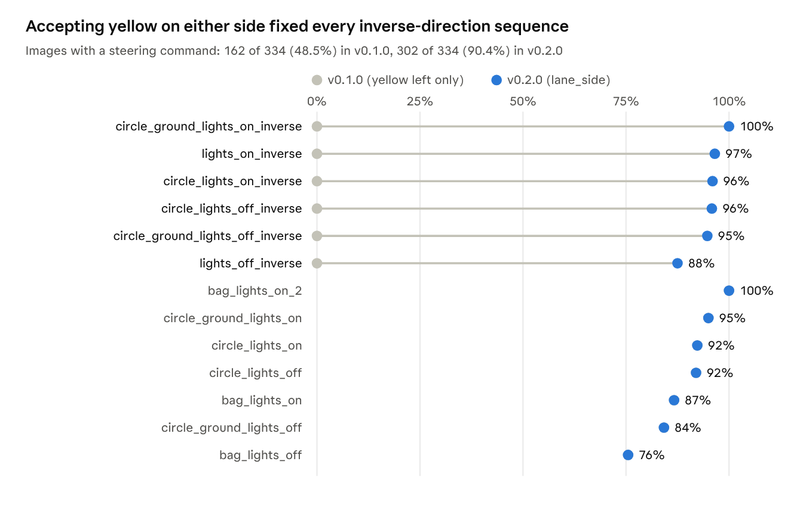

<div align="center">

# TurtleBot3 Lane Follower — Deep Learning

**Autonomous lane following on a real TurtleBot3 with U-Net semantic segmentation and ROS 2**

[](https://docs.ros.org/en/humble/)
[](https://www.python.org/)
[](https://pytorch.org/)
[](https://onnxruntime.ai/)
[](https://emanual.robotis.com/docs/en/platform/turtlebot3/overview/)
[](LICENSE)



<sub>What the robot sees while driving (8x speed): <b>pink</b> = yellow line, <b>cyan</b> = white line (both segmented by the U-Nets), <b>green</b> = lane centre used for steering.
<a href="docs/media/deep_learning_run_screen.mp4">Full 3-minute recording</a></sub>

**Part 2 of 2** · Part 1 (classical vision, ROBOTIS AutoRace): **[turtlebot3-autorace-lane-follower](https://github.com/AkramSakly/turtlebot3-autorace-lane-follower)**

</div>

---

## Highlights

- **Two U-Net CNNs** (13,665 parameters each) segment the yellow and white lines pixel by pixel.
- **Test IoU 0.828 (yellow) and 0.764 (white)**; lane-centre error **median 0.25–0.63 px**, **0 false lane pairs**.
- **Real time on CPU**: ~16 ms per network with ONNX Runtime, ~31 images/s for both.
- **Robust controller**: speed-scaled steering, smoothing, hold and recovery modes; smooth laps on the real robot from 0.035 to 0.15 m/s.
- **Works in both driving directions** and with room lights on or off.

## Contents

- [Machine learning pipeline](#machine-learning-pipeline)
- [System architecture](#system-architecture)
- [Dataset](#dataset)
- [Results](#results)
- [Repository structure](#repository-structure)
- [Getting started](#getting-started)
- [Evaluate and retrain](#evaluate-and-retrain)
- [Troubleshooting](#troubleshooting)
- [Limitations and future work](#limitations-and-future-work)
- [Acknowledgements](#acknowledgements)

## Machine learning pipeline

| Step | What we did |
| --- | --- |
| **Data collection** | 334 camera images recorded on the arena in 13 sequences (lights on/off, both driving directions) |
| **Labelling** | 264 images annotated by hand with polygons (`yellow_line`, `white_line`, LabelMe format) |
| **Supervised learning** | Train / validation / test split (183 / 61 / 14 labelled images), duplicates removed between splits |
| **Model** | Two U-Net convolutional neural networks, one per line colour, pixel-wise semantic segmentation |
| **Training** | PyTorch, BCE (line pixels x8) + Dice loss, Adam (lr 0.002), batch 8, 12 epochs, flip + brightness augmentation |
| **Model selection** | Best epoch and decision threshold chosen on the validation set (IoU) |
| **Evaluation** | IoU, Dice/F1, precision, recall, specificity, pixel accuracy, confusion matrices, lane-centre error |
| **Deployment** | Exported to ONNX, real-time inference inside a ROS 2 node driving the robot |

## System architecture

<p align="center"></p>

<p align="center"></p>

**Steering law** (LANE mode), with lane centre *c* and look-ahead centre *l* in [0, 1]:

```
k        = max(1, v_max / 0.05)                       # steering grows with speed
omega    = clip(k · [1.7 (0.5 − c) + 1.3 (c − l)],  ±min(1.5, 0.55 k))
v        = v_max · (1 − 0.65 |omega| / omega_lim)       # slow down in curves
command  = 0.5 · previous + 0.5 · new                   # smoothing
```

## Dataset

334 images (800x600) from 13 recording sequences: `bag`, `circle`, `circle_ground`, each with lights on / off,
plus `inverse` sequences driven in the opposite direction (yellow line on the right).
264 images are labelled; the dataset (~220 MB) is not included in this repository.

| Split | All images | Labelled (used for training/evaluation) |
| --- | --- | --- |
| Train | 229 | 183 |
| Validation | 61 | 61 |
| Test | 44 | 14 |

## Results

### Segmentation

| Network | Split | IoU | Dice/F1 | Precision | Recall | Pixel acc. |
| --- | --- | --- | --- | --- | --- | --- |
| Yellow | Train | 0.837 | 0.911 | 0.906 | 0.917 | 0.997 |
| Yellow | Validation | 0.718 | 0.836 | 0.829 | 0.842 | 0.994 |
| Yellow | **Test** | **0.828** | **0.906** | 0.893 | 0.919 | 0.997 |
| White | Train | 0.773 | 0.872 | 0.898 | 0.848 | 0.997 |
| White | Validation | 0.632 | 0.775 | 0.855 | 0.708 | 0.994 |
| White | **Test** | **0.764** | **0.866** | 0.872 | 0.861 | 0.997 |

Pixel accuracy is high mainly because ~98% of each image is background; IoU and Dice are the meaningful scores.
Confusion matrices and specificity: [`results/metrics_all.md`](results/metrics_all.md).

### Lane centre (image 256 px wide)

| Split | Lane pairs found / labelled | False pairs | Median error | Mean error |
| --- | --- | --- | --- | --- |
| Train | 161 / 167 | 0 | 0.25 px | 0.77 px |
| Validation | 56 / 57 | 0 | 0.25 px | 0.66 px |
| Test | 13 / 13 | 0 | 0.63 px | 5.15 px (0.54 px without one 60.5 px outlier) |

### Lane detection on all 334 images

<p align="center"></p>

### Speed

| Network | Parameters | Inference (mean / p95) |
| --- | --- | --- |
| Yellow U-Net | 13,665 | 16.2 / 25.6 ms |
| White U-Net | 13,665 | 16.1 / 25.3 ms |

ONNX Runtime, 2 CPU threads, 256x192 input.

The full analysis (dataset, training, all metrics, camera calibration, control, robot tests) is in the
**[project report (PDF)](report/report.pdf)**.

## Repository structure

```
turtlebot3-lane-follower/
├── ros2_package/tb3_lane_center/     # ROS 2 package (v0.4.0)
│   ├── tb3_lane_center/node.py       #   ROS 2 node: inference, controller, safety
│   ├── tb3_lane_center/vision.py     #   lane centre, steering law, recovery
│   ├── models/                       #   yellow_line.onnx, white_line.onnx, training metrics
│   ├── train.py                      #   original training script
│   ├── train_with_loss_log.py        #   training with per-epoch loss log, both networks
│   ├── evaluate_all.py               #   all segmentation + lane-centre metrics
│   └── data.py                       #   LabelMe polygons -> masks
├── scripts/
│   ├── start_robot.sh                # opens 5 terminal tabs and starts everything
│   └── record_overlay.py             # records the robot's view to MP4
├── calibration/                      # camera calibration (800x600 and scaled 320x240)
├── results/                          # metrics, per-image detection results, figures
├── docs/                             # demo media and diagrams
└── report/report.pdf                 # full project report
```

## Getting started

### Prerequisites

- TurtleBot3 Burger with Raspberry Pi camera (OV5647), ROS 2 Humble on robot and PC
- PC: Python 3.10, ONNX Runtime (no GPU needed)

### Installation (PC)

```bash
sudo apt install ros-humble-cv-bridge python3-scipy python3-pil python3-numpy
pip install onnxruntime
mkdir -p ~/tb3_dl_ws/src && cp -r ros2_package/tb3_lane_center ~/tb3_dl_ws/src/
cd ~/tb3_dl_ws && colcon build --symlink-install --packages-select tb3_lane_center
source install/setup.bash
```

### Camera calibration (robot)

```bash
mkdir -p ~/.ros/camera_info
cp calibration/ov5647__base_soc_i2c0mux_i2c_1_ov5647_36_320x240.yaml ~/.ros/camera_info/
```

### Run

```bash
# Robot, terminal 1
export TURTLEBOT3_MODEL=burger LDS_MODEL=LDS-01 ROS_DOMAIN_ID=30
ros2 launch turtlebot3_bringup robot.launch.py

# Robot, terminal 2
ros2 run camera_ros camera_node --ros-args -p format:='RGB888' -p width:=320 -p height:=240

# PC — preview first (robot does not move), then add -r lane_cmd_vel:=/cmd_vel to drive
ros2 run tb3_lane_center follow --ros-args -r image_raw:=/camera/image_raw -r lane_cmd_vel:=/cmd_vel \
  -p lane_side:=yellow_left -p max_camera_age:=0.6 -p max_speed:=0.10 -p recovery_time:=3.0

# Camera view with overlay
ros2 run rqt_image_view rqt_image_view /lane_overlay
```

**Stop:** Ctrl+C in the follower terminal, then `ros2 topic pub --once /cmd_vel geometry_msgs/msg/Twist "{}"`.
Or start everything at once with [`scripts/start_robot.sh`](scripts/start_robot.sh) (set `PI_IP` first).

### Parameters

| Parameter | Default | Description |
| --- | --- | --- |
| `max_speed` | 0.035 | Top forward speed in m/s (up to 0.22) |
| `lane_side` | `auto` | `yellow_left`, `yellow_right` or `auto` |
| `max_camera_age` | 0.4 | Oldest camera image still used, in s |
| `recovery_time` | 1.5 | How long recovery may steer with one line, in s (0 = off) |
| `hold_time` | 0.3 | Keeps the last command through a short lane loss, in s |
| `smoothing` | 0.5 | Command smoothing, 0 (none) to 0.9 (very smooth) |

## Evaluate and retrain

```bash
cd ros2_package/tb3_lane_center
# All metrics for both networks (no training, ~1 min)
python3 evaluate_all.py /path/turtlebot3_autorace_dataset_to_fill.zip --out results_all
# Retrain with a per-epoch loss log (needs PyTorch)
python3 train_with_loss_log.py /path/turtlebot3_autorace_dataset_to_fill.zip --label white_line  --out run_white
python3 train_with_loss_log.py /path/turtlebot3_autorace_dataset_to_fill.zip --label yellow_line --out run_yellow
```

## Troubleshooting

| Symptom | Fix |
| --- | --- |
| `Package 'tb3_lane_center' not found` | `source ~/tb3_dl_ws/install/setup.bash` in that terminal |
| `Camera age 0.4xx s: preview only` | Wi-Fi delay or Pi/PC clock offset: `-p max_camera_age:=0.6`, sync clocks with chrony |
| `MODE: STOP (no lane)` | Put the robot in the lane with both lines in view |
| Zig-zag at high speed | Lower `max_speed` one step or raise `smoothing` |
| Nothing in `ros2 topic echo` | `export ROS_DOMAIN_ID=30`, then `ros2 node list` |

## Limitations and future work

- Small labelled test set (14 images); one image drives most of the test centre error.
- About 0.45 s camera delay over Wi-Fi limits the safe top speed. Next: compressed images or on-robot inference.
- No obstacle detection.
- Next: more labelled curve images, retrain with loss curves, compare directly with Part 1 on the same track.

## Acknowledgements

- [ROBOTIS TurtleBot3](https://emanual.robotis.com/docs/en/platform/turtlebot3/overview/) platform and ROS 2 packages
- [ONNX Runtime](https://onnxruntime.ai/) and [PyTorch](https://pytorch.org/)
- U-Net: Ronneberger, Fischer and Brox, *U-Net: Convolutional Networks for Biomedical Image Segmentation*, MICCAI 2015

## Author

[@AkramSakly](https://github.com/AkramSakly)

## License

[MIT](LICENSE)
